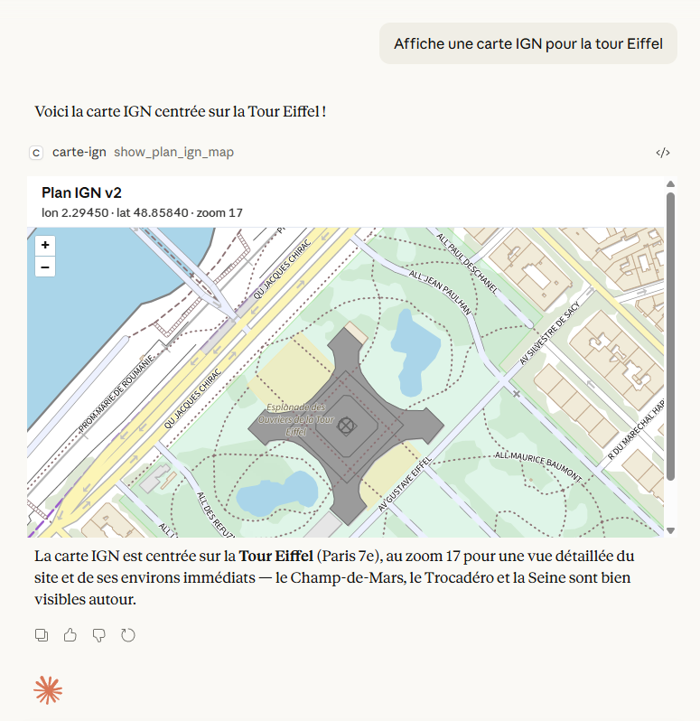

# mcp-carto

> **WARNING** : The whole code for this PoC is AI generated with Cursor and **not reviewed**.

An [MCP App](https://modelcontextprotocol.io/extensions/apps/overview) that embeds an interactive **Plan IGN v2** map (French national mapping) in hosts such as Cursor or Claude Desktop, using OpenLayers and the official [Géoplateforme](https://data.geopf.fr/) WMTS tiles.



## Requirements

- **Node.js** 20 or newer (22 LTS recommended; matches the project’s tooling).
- **Network access** to `https://data.geopf.fr` so the UI can load map tiles.
- A **client that supports MCP Apps** (interactive UI resources). Standard MCP-only clients will see the tool result text but not the map surface.

## Setup

```bash
npm install
npm run build
```

The build compiles the server and bundles `mcp-app.html` (OpenLayers + Plan IGN v2 layer) into `dist/`. The running server reads that file from `dist/`, so rebuild after UI changes.

## Usage

### HTTP transport (Streamable HTTP)

```bash
npm run serve
```

Default URL: `http://localhost:3001/mcp` (see [Parameters](#parameters) for customization)


**Exemple with Claude Desktop** :

```json
{
  "mcpServers": {
    "carto": {
      "command": "npx",
      "args": [
        "mcp-remote",
        "http://localhost:3001/mcp"
      ]
    }
  }
}
```

### Stdio transport (typical for Cursor / local MCP)

From the project root:

```bash
npm run serve:stdio
```

Point your MCP configuration at this command so the host spawns the process and talks over stdin/stdout.

**Example (Cursor `mcp.json`):** adjust `cwd` to your clone.

```json
{
  "mcpServers": {
    "carto": {
      "command": "npm",
      "args": ["run", "serve:stdio"],
      "cwd": "/path/to/mcp-carto"
    }
  }
}
```

Ensure `npm run build` has been run at least once before the first run.

## Tools

### `show_plan_ign_map`

Call this tool to open or update the map view.

| Argument      | Type    | Description                                                                                                    |
| ------------- | ------- | -------------------------------------------------------------------------------------------------------------- |
| `title`       | string? | Optional. View title (default: `"Carte IGN"`).                                                                 |
| `description` | string  | View description.                                                                                              |
| `background`  | string? | Optional. Base map background. One of: `"plan_ign_v2"` (default) or `"orthophotos"`.                           |
| `lon`         | number  | Longitude in decimal degrees (WGS84), −180…180                                                                 |
| `lat`         | number  | Latitude in decimal degrees (WGS84), −90…90                                                                    |
| `zoom`        | number? | Optional. Zoom level **0–19** (default **12**). 19 is the maximum for Plan IGN v2 (`PM_0_19`).                 |
| `layers`      | Object? | Optional. A list of GeoJSON layers to load on top of the selected base layer (with title, color and data_url). |

When `layers` is provided, the app fetches the GeoJSON, displays them as a vector overlays, and automatically fits the map view to the data extent.

Example:

```json
{
  "title": "Carte IGN",
  "description": "Buildings within 500m around Chamonix center",
  "background": "orthophotos",
  "lon": 6.869322,
  "lat": 45.923713,
  "zoom": 12,
  "layers": [{ 
    "title": "Batiments",
    "color": "red",
    "data_url": "https://data.geopf.fr/wfs?service=WFS&request=GetFeature&typeName=BDTOPO_V3%3Abatiment&outputFormat=application%2Fjson&cql_filter=DWITHIN%28geometrie%2CPoint%2845.923713+6.869322%29%2C500%2Cmeters%29"
  }]
}
```

The UI resource URI is `ui://mcp-carto/mcp-app.html`.

## Development

- **`npm run dev`** — watch-rebuild the UI and run the HTTP server with reload.
- **`npm run watch:ui`** — rebuild the bundled HTML on file changes only.

## Parameters

For advanced configuration.

| Name                | Description                                                                             | Default |
| ------------------- | --------------------------------------------------------------------------------------- | ------- |
| `HTTP_PORT`         | TCP port used by the Streamable HTTP transport when running `npm run serve`.            | `3001`  |
| `HTTP_MCP_ENDPOINT` | HTTP route path used by the Streamable HTTP transport. The value should start with `/`. | `/mcp`  |


## License

[MIT](LICENSE)

## Resources

- [MCP Apps overview](https://modelcontextprotocol.io/extensions/apps/overview)
- [ignfab/demo-geocontext - ol-simple-map](https://github.com/ignfab/demo-geocontext/tree/main/front#principe) : the first attempt with a web component
